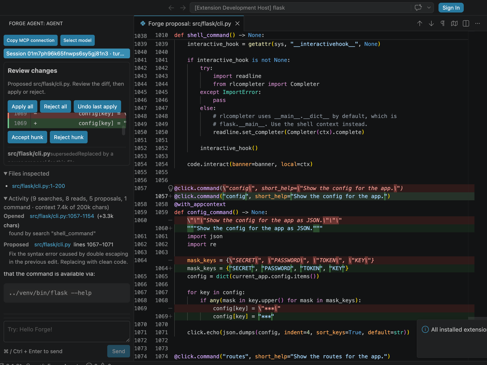
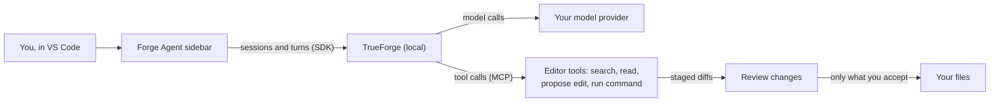

# Forge Agent

A coding agent for VS Code that runs on [TrueForge](https://github.com/truefoundry/trueforge). You ask; it searches, reads and proposes changes; nothing reaches your files until you accept it.



<sub>A real run on Flask: the agent ran the tests, saw a syntax error it had introduced, and proposed the fix. On the left, Review changes and the live activity feed; in the editor, the diff waiting for you.</sub>

## What it does

- **Ask in the sidebar, or select code and press ⌘⌥F** to change just that selection.
- **Shows its work as it goes.** Every search, file read, edit and command appears in an activity feed, with the agent's reason and how much context it used.
- **You decide what gets written.** Edits are staged as diffs. Accept or reject each hunk, apply a file or everything, and undo the last apply.
- **Runs your tests when you say so.** Commands always ask first and show the exact command and folder. At most three per request.
- **Keeps context in check.** Each request gets a 200,000-character budget for what it reads; long conversations are compacted by TrueForge.
- **Survives a bad model.** Temporary errors are retried; after that the session continues on a fallback model you choose.

## How it works



TrueForge runs the agent loop and is the only thing that talks to the model. The extension never calls a model; it gives TrueForge a small set of editor tools over a local, token-protected MCP server, and shows you what happens.

## Quick start

You need Node.js 22+, pnpm, VS Code with the `code` command, and a model key. A free Google Gemini key works.

```sh
git clone https://github.com/Mukulyadav2004/forge-agent.git && cd forge-agent
pnpm install --frozen-lockfile

pnpm run trueforge:local                  # terminal 1: TrueForge 0.185.1 on http://127.0.0.1:8790

export GEMINI_API_KEY=...                 # terminal 2: your key stays in your shell and in TrueForge
pnpm run trueforge:add-provider examples/model-provider.gemini.json
pnpm run dev                              # opens VS Code with the extension loaded
```

In the new window, open the Forge Agent icon in the activity bar, click **Select model**, and ask something.

## Agent definition and models

- The agent TrueForge runs is [src/agent/forge-agent.json](src/agent/forge-agent.json) plus the instructions in [src/agent/instructions.ts](src/agent/instructions.ts). The extension sends it with every new session, so there is nothing to import. `pnpm run agent:spec` prints exactly what TrueForge receives.
- Model configs live in [examples/](examples). Keys are filled from your environment, never stored in the repo.
- Set **Forge Agent: Fallback Model** in VS Code settings to a second model, ideally on a different key or provider, so one failure cannot take out both.

## Checking a run

```sh
pnpm run test                  # type check, integration, edit and native VS Code tests
pnpm run eval:session --last   # what the agent did in the last session, and anything that went wrong
```

## Limitations

- Free model tiers have per-minute limits; a multi-file task can hit them, and the agent then waits or switches models.
- Small models make mistakes, like escaping quotes in Python. The review step and the test loop are how you catch them.
- No creating, deleting or renaming files yet. `run_command` is tested on macOS only.
- The context budget counts characters, not tokens.

## More

- [Detailed guide](docs/GUIDE.md): full setup notes, every feature, apply and undo, verification.
- [Step notes](docs/STEP-NOTES.md): what changed and why, step by step.
- [Task A rehearsal](docs/TASK-A.md) and [Cline reuse decisions](docs/CLINE-REUSE.md).

## Credits and licence

Built from scratch for the TrueFoundry Forge-a-thon; it is not a fork. A few editor pieces (the diff preview, diff rows, sidebar layout, ripgrep search handling and the `old_text`/`insert_line` edit rules) are adapted from [Cline](https://github.com/cline/cline) at commit `7a7878cb52fc33967d8b464b3e3d899beac42d4d`, under Apache-2.0. Cline's agent loop and provider code are not used. Details and attribution are in [THIRD_PARTY_NOTICES.md](THIRD_PARTY_NOTICES.md) and the [guide](docs/GUIDE.md#starting-point-upstream-source-and-licence).

Licensed under [Apache-2.0](LICENSE).
