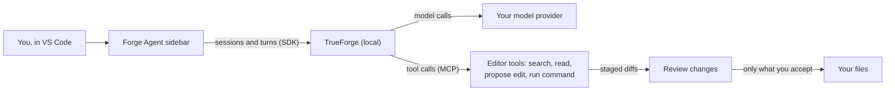

# Forge Agent

A coding agent for VS Code that runs on [TrueForge](https://github.com/truefoundry/trueforge). You ask; it searches, reads and proposes changes; nothing reaches your files until you accept it.


<sub>A real run on Flask: the agent ran the tests, saw a syntax error it had introduced, and proposed the fix. On the left, Review changes and the live activity feed; in the editor, the diff waiting for you.</sub>

## What it does

- **Ask in the sidebar, or select code and press ⌘⌥F** to change just that selection.
- **Shows its work as it goes.** Every search, file read, edit and command appears in an activity feed, with the agent's reason and how much context it used.
- **You decide what gets written.** In agent mode each edit pauses for your review: its diff opens, you keep or reject each hunk, and **Approve** saves the hunks you kept, so the agent can run the tests on them and fix what fails in the same request (TrueForge tool approval drives the review). Nothing reaches disk before you approve. **Undo last apply** and **Undo this request** restore saved files, also after Cancel. Edit Selection, or `forgeAgent.saveOnApprove` set to off, keeps staged review: apply hunks, a file or everything after the request.
- **Runs your tests when you say so.** Commands always ask first and show the exact command and folder. If the tests need setup, it proposes a virtual environment inside the project and the project's declared test dependencies, one approved command at a time; never system-wide installs. At most fifteen commands per request.
- **Keeps context in check.** Each session's instructions end with the model's identity, the workspace's AGENTS.md or CLAUDE.md if it has one, and an `<env>` block (date, folder, git, platform). Each chat starts with a project overview (folders and how tests run); each request gets a 350,000-character budget for what it reads; long conversations are compacted by TrueForge.
- **@-mentions.** Type `@src/flask/cli.py` (or `@"path with spaces"`) to attach a file, or `@routes_command` to attach that name's definition (with its decorators), found by a definition search. Mentions count in the request's budget and appear in the feed.
- **Survives a bad model.** Temporary errors are retried; after that the session continues on a fallback model you choose.

## How it works



TrueForge runs the agent loop and is the only thing that talks to the model. The extension never calls a model; it gives TrueForge a small set of editor tools over a local, token-protected MCP server, and shows you what happens.

## Quick start

Tested on macOS. You need:

- **Node.js 22+** and **pnpm**: run `corepack enable` once to get the pinned pnpm version.
- **VS Code** with the `code` command on your PATH. To add it, open the Command Palette in VS Code and run *Shell Command: Install 'code' command in PATH*.
- **Python 3**, only for the fixed tasks below.
- **A model key.** A free Google Gemini key from [aistudio.google.com/apikey](https://aistudio.google.com/apikey) works.

```sh
git clone https://github.com/Mukulyadav2004/forge-agent.git && cd forge-agent
pnpm install --frozen-lockfile

# Terminal 1: start TrueForge 0.185.1 on http://127.0.0.1:8790 and leave it running
pnpm run trueforge:local

# Terminal 2, in the forge-agent folder:
export GEMINI_API_KEY=your-key            # stays in this shell and in TrueForge, never in the repo
pnpm run trueforge:add-provider examples/model-provider.gemini.json
pnpm run dev                              # opens a VS Code window with the extension loaded
```

`trueforge:add-provider` prints the models it added, for example `google-gemini/gemini-3-1-flash-lite`. On Windows PowerShell, set the key with `$env:GEMINI_API_KEY="your-key"`.

`pnpm run dev` opens an **empty** VS Code window titled *Extension Development Host*. In that window:

1. Use **File → Open Folder** to open a project, and click **Trust** when asked. The fixed tasks below use a prepared Flask checkout.
2. Click the Forge Agent icon in the activity bar, then **Select model**, and choose `google-gemini/gemini-3-1-flash-lite`.
3. Ask something in the chat box, or select code and press **⌘⌥F** (Ctrl+Alt+F on Windows/Linux).

To use another Gemini model, add it to the `models` list in `examples/model-provider.gemini.json` and run `add-provider` again. For any OpenAI-compatible endpoint, copy that file with `"type": "custom"` and the endpoint's `base_url`; the model must support tool calling.

## Try the three fixed tasks

The tasks use Flask 3.1.3 (commit `22d92470`), cloned into the ignored folder `out-test/task-a/flask`. Run these in terminal 2, from the `forge-agent` folder:

```sh
pnpm run task:a:prepare                   # clone Flask 3.1.3 and check the untouched behaviour
cd out-test/task-a/flask
python3 -m venv .venv && .venv/bin/pip install -e . pytest python-dotenv asgiref
cd ../../..
pnpm run task:a:open                      # opens Flask in the Extension Development Host
```

The `.venv` inside Flask lets the agent run `.venv/bin/pytest` when it tests its own change. In the new window, open a terminal, run `source .venv/bin/activate`, then click **Select model**.

**A. Inline edit.**
1. In `src/flask/helpers.py`, select the whole `get_debug_flag` function.
2. Press **⌘⌥F**. Don't type into the chat box: that runs agent mode.
3. Enter: `Treat the values 'off' and 'n' as false as well, case-insensitively, and update the docstring to list every value that is treated as false.`
4. Accept or reject each hunk, then check:

```sh
FLASK_DEBUG=off python -c "from flask.helpers import get_debug_flag; print(get_debug_flag())"   # False
```

**B. Agent mode.** Click **New Task** and send this in the chat box, with no files named:

```text
Add a new built-in CLI command flask config that prints the loaded application's configuration as JSON, masking the values of any key containing SECRET, PASSWORD, TOKEN or KEY as "***". It must appear in flask --help, be covered by a test, and be documented alongside the other built-in commands.
```

Review each edit and Approve, and approve the agent's test command. Then check:

```sh
python -m pytest tests/test_cli.py -q
git diff --stat                           # at least 3 files
mkdir -p /tmp/flask-demo && printf 'from flask import Flask\napp = Flask(__name__)\napp.config["SECRET_KEY"] = "s3cret"\napp.config["GREETING"] = "hello"\n' > /tmp/flask-demo/hello.py
cd /tmp/flask-demo && flask --app hello --help && flask --app hello config   # SECRET_KEY shows "***"
```

**C. Resilience.** First click **Undo this request** in Review changes, or run `git checkout -- .` in the Flask folder. Then:

```sh
pnpm run trueforge:add-provider examples/model-provider.task-c-invalid-key.json   # a deliberately fake key
```

In VS Code Settings, set **Forge Agent: Model** to `taskc-invalid-key/gemini-3-1-flash-lite` and **Forge Agent: Fallback Model** to `google-gemini/gemini-flash-lite-latest`. Click **New Task** and repeat Task A. The chat shows the failure, then continues on the fallback model. Run `git status` before you approve: no files have changed. Afterwards, clear **Fallback Model** and select your normal model again.

## Troubleshooting

- **`Port 8790 is already in use`:** an older TrueForge is still running. Find its process ID with `lsof -nP -iTCP:8790 -sTCP:LISTEN`, then run `kill <PID>`, or stop it with Ctrl+C in its terminal.
- **No models in Select model:** TrueForge was restarted or the key wasn't set. Run `export GEMINI_API_KEY=...` and `add-provider` again.
- **`Could not launch VS Code`:** the `code` command isn't on your PATH (see above).
- **Forge commands are missing, or an old behaviour persists:** close the Extension Development Host and run `pnpm run dev` again. A normal VS Code window doesn't load the development extension.
- **`git status` in Flask shows `.venv/`:** that's the test environment you created; it isn't a change by the agent.

## Agent definition and models

- The agent TrueForge runs is [src/agent/forge-agent.json](src/agent/forge-agent.json) plus the instructions in [src/agent/instructions.ts](src/agent/instructions.ts). The extension sends it with every new session, so there is nothing to import. `pnpm run agent:spec` prints exactly what TrueForge receives.
- Model configs live in [examples/](examples). Keys are filled from your environment, never stored in the repo.
- Set **Forge Agent: Fallback Model** in VS Code settings to a second model, ideally on a different key or provider, so one failure cannot take out both.

## Checking a run

```sh
pnpm run test                  # type check, integration, edit and native VS Code tests
pnpm run eval:session --last   # what the agent did in the last session, and anything that went wrong
```

## Limitations

- Free model tiers have per-minute limits; a multi-file task can hit them, and the agent then waits or switches models.
- Small models make mistakes, like escaping quotes in Python. The review step and the test loop are how you catch them.
- The agent can create new files (`write_file`) but not delete or rename them. `run_command` is tested on macOS only.
- The context budget counts characters, not tokens.

## More

- [Detailed guide](docs/GUIDE.md): full setup notes, every feature, apply and undo, verification.
- [Step notes](docs/STEP-NOTES.md): what changed and why, step by step.
- [Task A rehearsal](docs/TASK-A.md) and [Cline reuse decisions](docs/CLINE-REUSE.md).

## Credits and licence

Built from scratch for the TrueFoundry Forge-a-thon; it is not a fork. A few editor pieces (the diff preview, diff rows, sidebar layout, ripgrep search handling and the `old_text`/`insert_line` edit rules) are adapted from [Cline](https://github.com/cline/cline) at commit `7a7878cb52fc33967d8b464b3e3d899beac42d4d`, under Apache-2.0. The tolerant `old_text` matching in `src/edits/match.ts` is ported from [opencode](https://github.com/anomalyco/opencode) (MIT). Cline's agent loop and provider code are not used. Details and attribution are in [THIRD_PARTY_NOTICES.md](THIRD_PARTY_NOTICES.md) and the [guide](docs/GUIDE.md#starting-point-upstream-source-and-licence).

Licensed under [Apache-2.0](LICENSE).
