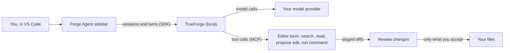

# Forge Agent

A coding agent for VS Code that runs on [TrueForge](https://github.com/truefoundry/trueforge). You ask; it searches, reads and proposes changes; nothing reaches your files until you accept it.


<sub>A real run on Flask: the agent ran the tests, saw a syntax error it had introduced, and proposed the fix.</sub>

## What it does

- **Two ways to ask:** chat in the sidebar (agent mode), or select code and press **⌘⌥F** to change only that selection.
- **You decide what gets written:** each edit opens as a diff; you keep or reject each hunk, and **Approve** saves the rest. **Undo** restores the files, even after Cancel.
- **Shows its work:** every search, read, edit and command appears in a live feed, with the agent's reason and the context it used (350,000-character budget per request). Long sessions are compacted by TrueForge.
- **Asks before running commands:** each command shows the exact command and folder for approval.
- **Survives a bad model:** temporary errors are retried, then the session continues on a fallback model you choose.

## How it works



TrueForge runs the agent loop and is the only thing that talks to the model. The extension gives it editor tools over a local, token-protected MCP server. The agent definition is [src/agent/forge-agent.json](src/agent/forge-agent.json) plus [src/agent/instructions.ts](src/agent/instructions.ts); the extension sends it with every new session, so there is nothing to import.

## Quick start

Tested on macOS. You need Node.js 22+, Python 3 (for the tasks), VS Code with the [`code` command](https://code.visualstudio.com/docs/setup/mac#_launch-vs-code-from-the-command-line), and a model key ([a free Gemini key](https://aistudio.google.com/apikey) works).

```sh
git clone https://github.com/Mukulyadav2004/forge-agent.git && cd forge-agent
pnpm install --frozen-lockfile

pnpm run trueforge:local       # terminal 1: TrueForge on http://127.0.0.1:8790, leave it running

export GEMINI_API_KEY=your-key # terminal 2: the key stays in your shell and in TrueForge
pnpm run trueforge:add-provider examples/model-provider.gemini.json
pnpm run dev                   # opens an empty VS Code window with the extension loaded
```

In that window: **File → Open Folder** and click **Trust**, open the Forge Agent icon, then **Select model** → `google-gemini/gemini-3-1-flash-lite`.

Other models: add them to [examples/model-provider.gemini.json](examples/model-provider.gemini.json), or copy it with `"type": "custom"` and a `base_url` for any OpenAI-compatible endpoint (the model must support tool calling).

## Try the three fixed tasks

```sh
pnpm run task:a:prepare        # clones Flask 3.1.3 into out-test/task-a/flask
(cd out-test/task-a/flask && python3 -m venv .venv && .venv/bin/pip install -e . pytest python-dotenv asgiref)
pnpm run task:a:open           # opens Flask with the extension loaded
```

In that window's terminal, run `source .venv/bin/activate`. Use **New Task** before each task.

<details>
<summary><b>A. Inline edit</b>: select <code>get_debug_flag</code> in <code>src/flask/helpers.py</code>, press ⌘⌥F</summary>

Enter: `Treat the values 'off' and 'n' as false as well, case-insensitively, and update the docstring to list every value that is treated as false.` Review the hunks, then check:

```sh
FLASK_DEBUG=off python -c "from flask.helpers import get_debug_flag; print(get_debug_flag())"   # False
```
</details>

<details>
<summary><b>B. Agent mode</b>: send the instruction in the chat box, no files named</summary>

```text
Add a new built-in CLI command flask config that prints the loaded application's configuration as JSON, masking the values of any key containing SECRET, PASSWORD, TOKEN or KEY as "***". It must appear in flask --help, be covered by a test, and be documented alongside the other built-in commands.
```

Approve the edits and the test command, then check:

```sh
python -m pytest tests/test_cli.py -q && git diff --stat
mkdir -p /tmp/demo && printf 'from flask import Flask\napp = Flask(__name__)\napp.config["SECRET_KEY"] = "s3cret"\n' > /tmp/demo/hello.py
cd /tmp/demo && flask --app hello --help && flask --app hello config   # SECRET_KEY is "***"
```
</details>

<details>
<summary><b>C. Resilience</b>: a fake key, then automatic fallback</summary>

Undo Task A first (**Undo this request**). Then `pnpm run trueforge:add-provider examples/model-provider.task-c-invalid-key.json`, set **Forge Agent: Model** to `taskc-invalid-key/gemini-3-1-flash-lite` and **Forge Agent: Fallback Model** to `google-gemini/gemini-flash-lite-latest`, and repeat Task A. The chat shows the failure and continues on the fallback; `git status` shows no changes before you approve.
</details>

<details>
<summary><b>Troubleshooting</b></summary>

- **Port 8790 already in use:** an old TrueForge is running. `lsof -nP -iTCP:8790 -sTCP:LISTEN` shows its PID; `kill <PID>`.
- **No models to select:** export the key and run `add-provider` again.
- **Old behaviour or missing commands:** close the Extension Development Host and run `pnpm run dev` again.
- **Checks:** `pnpm run test` runs all tests; `pnpm run eval:session --last` summarises the last agent session.
</details>

## Limitations

- Small models make mistakes and free tiers hit rate limits; review and the test loop are how you catch them.
- The agent can create files but not delete or rename them. `run_command` is tested on macOS only.
- The context budget counts characters, not tokens.

More in the [detailed guide](docs/GUIDE.md) and [step notes](docs/STEP-NOTES.md).

## Credits and licence

Built from scratch; not a fork. A few editor pieces (diff preview, diff rows, sidebar layout, ripgrep search handling, edit rules) are adapted from [Cline](https://github.com/cline/cline) at commit `7a7878cb52fc33967d8b464b3e3d899beac42d4d` (Apache-2.0), and tolerant edit matching from [opencode](https://github.com/anomalyco/opencode) (MIT). Cline's agent loop and provider code are not used. See [THIRD_PARTY_NOTICES.md](THIRD_PARTY_NOTICES.md).

Licensed under [Apache-2.0](LICENSE).
