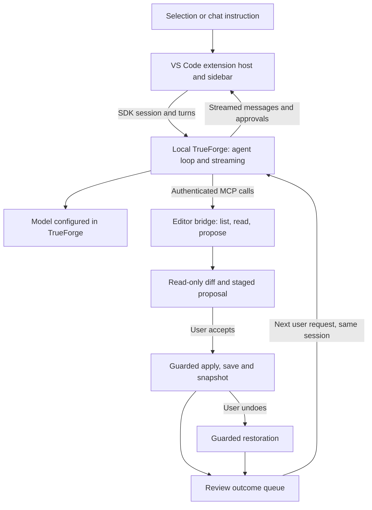

# Forge Agent: planning, development and problem history

Reconstructed on **10 November 2026**, through the Apply and Undo milestone. This is a project retrospective from the available conversation, Git history, source, test reports and existing notes. It is not a complete transcript or a count of messages/hours. Earlier planning dates are approximate; commit dates below come from Git. Historical test results are labelled separately from current verification. [BRIEF.md](BRIEF.md) remains the competition reference; [AGENTS.md](../AGENTS.md) contains the current working rules.

## 1. Where we started and what we planned

The starting point was a beginner's understanding of VS Code extensions and agent infrastructure, followed by a local Cline checkout and a new Forge Agent repository. The objective became a VS Code client for local TrueForge: reuse suitable editor code while TrueForge owns model calls, sessions and the agent loop. Two teammates were available, with named ownership still undecided. The proposed split was TrueForge/MCP integration versus sidebar/editor review, with shared contracts agreed before parallel work.

The initial plan was labelled 3 November and targeted submission on 19 November, keeping 20 November as buffer. The implementation target was later brought forward to **15 November** for senior/teacher review. Registration closes on 15 November; the official submission deadline recorded in the brief is 20 November, 23:59 IST. These targets are plans, not evidence that registration or submission has happened.

| Planning discussion | Outcome and present status |
| --- | --- |
| Understand the stack before asking Codex to build it | Discussed editors, extensions, plugins, skills, MCP tools, models, agent loops and Cline; requested a 30-question learning curriculum, including context compaction. This retrospective does not reconstruct a question list that is not saved in the inspected repo. |
| Fork Cline or start a new repository? | Chose a fresh extension with selective Cline adaptation. The user clarified that a fresh repo still means reusing as much suitable editor code as possible. Cline's reputation was discussed; no comparative benchmark established that other projects were retired or inferior. |
| Six early integration spikes | Planned SDK streaming, MCP reachability, approval/resume, cancellation, bad-key behavior and Task B feasibility. Later evidence verifies parts of this plan, not all six as a completed checklist. |
| Intended final product | Inline selection editing, streaming panel, mentions, context ledger, per-hunk review, batch apply/undo, search/symbol tools, commands, fallback and a scout subagent. Some remain unbuilt; see section 7. |
| Context engineering | Planned bounded retrieval and a visible TrueForge feature. Retrieval, compaction and skills were distinguished: compaction manages conversation length; it does not replace finding relevant source. TrueForge should own compaction/subagents. No demonstrated compaction or scout event is recorded here. |
| Sandbox and local model choices | Discussed local Docker versus Daytona and running a model on a 16 GB Apple Silicon Mac. A sandbox is optional for the fixed tasks; no sandbox integration or local coding-model benchmark is verified. Model hosting is not the project goal. |
| Demo and submission strategy | Planned a video of at most four minutes showing A, B and C, plus a short write-up. The video-cut wording needs organizer clarification. Suggested cuts to polish/scout/fallback were planning trade-offs, not awarded rubric scores. |

## 2. The system we have been building

The extension never calls the model provider directly. The model can propose an edit; only the user's review action saves it. TrueForge approval to stage a proposal and the editor's acceptance to write it are separate decisions. Current editor tools are `list_files`, `read_file` and `propose_edit`; search and command execution are not present yet.

## 3. Chronology supported by Git and records

| Anchor | What it establishes |
| --- | --- |
| Planning conversation, before the first commit | Scope, learning questions, reuse strategy, team split and deadline plan. Exact conversation dates are not independently established. |
| 5 Nov — `05ffce1` Initial commit | Fresh repository/scaffold. There is no Cline ancestor in this Git history. The handoff document's “November 4–5” label is a notes label, not proof of a November 4 commit. |
| 6 Nov quality notes | Real model connectivity and architecture-response evaluation were recorded; formatting and reasoning problems were separated. See [QUALITY-NOV6.md](QUALITY-NOV6.md). |
| 7 Nov — `278f134` | Markdown/Mermaid rendering support committed. |
| 8 Nov — `4e1a109` (`buid apply and undo`) | Cline preview adaptation and Forge's transaction implementation entered together; this was not a standalone upstream import. |
| 9 Nov — `43b55a3`, `a196d53` | Provenance/licence documentation and agent rules/brief committed. Per-hunk/ranged editing, structured-read investigation and one clean live Task A pass are recorded in the surrounding notes. |
| 10 Nov — `7f11620`, `9039d51` | Cline layout adaptation and editor-review feedback committed. Some step notes carry the prior day's date; the commit dates above are the Git anchors. |
| 10 Nov conversation and audit | User terminal output passed the Task A behavior/docstring verifier. The extension's full test command subsequently passed 25 edit tests, five integration tests and the native editor suite. Later Cline-reuse rule additions were still uncommitted when this retrospective began. |

## 4. Problems encountered, what changed and what remains uncertain

| Problem observed | Response, result and lesson |
| --- | --- |
| “What is an extension codebase?” and “replace the loop” were unclear | Established the separation between editor UI/tools and model/tool orchestration. A plugin is an integration/package concept; skills provide instructions/workflows. Neither is automatically required for every feature. The team's code must be explainable in the shortlist interview. |
| The suggested `forge-agent` folder did not exist | It was a proposed new project path, not an existing installation. The user created/opened it before extension development could proceed. |
| Confusion between the source window and Extension Development Host | Development commands appear in the host launched by F5/Run → Start Debugging or `pnpm run dev`. Opening a source folder alone does not load the extension. A suggested backtick window shortcut was not useful on the user's keyboard; menu-based navigation was needed. |
| `Forge: Open Agent` / `Copy Editor MCP Connection` missing | Checked the loaded development host/build rather than treating a missing palette command as an MCP failure. Explicit `code` development-path launching and command registration tests were added. |
| Pinned SDK could not be loaded through its CommonJS entry | Used esbuild to bundle the SDK into the extension's CommonJS output. Keep that build path; plain TypeScript emission is not equivalent. Recorded SDK version: 0.183.0. |
| `Outbound URL blocked for host "127.0.0.1"` | Local TrueForge needed an explicit loopback allowlist. The pinned local launcher supplies localhost/127.0.0.1 allowances while retaining outbound protections. Editing an unrelated `.env` cannot change an already running process. |
| Remote MCP transport failures and SSE 404 | Tool discovery and a label such as “Connected” did not prove usable requests. Required the actual MCP endpoint/transport, reachability and authentication to agree. Later discovery and MCP tests verified all three tools. |
| OAuth failed with missing `registration_endpoint` | The editor server did not implement dynamic client registration. The working integration uses its bearer header; choosing OAuth in the UI could not supply a missing OAuth implementation. |
| “Model not configured” and HTTP 422 for an unqualified name | TrueForge requires the exact configured `provider/model` name. Added server-backed model selection. A rejected session creation must not keep stale model settings after correction. |
| Opening another folder caused `ECONNREFUSED` on an old port | The editor server's port/token belong to an extension host. Automatic connector registration before session creation and per-window names replaced reliance on a manually entered stale endpoint. |
| Gemini quota failures, a zero-quota Pro configuration and a timed-out alias | Recorded provider failures separately from editor defects. A correct staged diff followed by a model 429 is not a clean completed agent run. Fallback and broader model compatibility remain unfinished. Local-model discussion did not establish a tested alternative. |
| Architecture output was OpenUI text rather than a useful rendered map | Unsupported generative UI was enabled by a harness default. Disabled unsupported interactions explicitly and added sanitized Markdown, Mermaid, tables and guarded local source links. Decorative complexity numbers had no evidence and were rejected as a quality signal. |
| A polished architecture explanation still misread DreamGym | Compared claims with implementations: collection ownership, dictionary policy updates and truncated functions were misinterpreted. Added source-grounding instructions and bounded implementation excerpts. Better formatting or reading seven files is not proof of correct reasoning. |
| Agent appeared to inspect too much instead of finding candidates | Discussed ripgrep-style discovery and bounded reads. Existing list/range tools and the seven-file/64,000-character architecture pre-seed are only partial context handling; query-driven search, ranking, selection reasons and token accounting are still missing. |
| `read_file` seemed to run, but the model did not receive source | Text content contained code while structured content held only the revision; TrueForge preferred the structured result. Added bounded source text/path/ranges to structured output. Native MCP checks and a live trace verified delivery. Earlier reasoning failures cannot be blamed solely on model quality without accounting for this defect. |
| Proposals opened a preview but could not be saved | Built guarded review acceptance and snapshots. The model has no apply tool; it directs the user to Accept hunk, Apply file or Apply all. This completed the write foundation, not all of agent mode. |
| File changes between reading, proposing, accepting or undoing could destroy work | Added task-bound read receipts, disk/editor version and physical-identity checks, dirty-buffer/alias protection, batch preflight, save verification and guarded Undo. Stale edits are refused; the user must request a fresh proposal. |
| A multi-file save could fail after some files were written | One editor batch is followed by separate saves, verification and rollback. Rollback preserves newer external edits; incomplete recovery blocks more writes and points to private snapshots. This is recoverable transaction behavior, not crash-atomic disk storage. |
| Per-hunk decisions could shift offsets or resurrect rejected lines | Compute hunks locally, compose only selected changes, refresh expected revisions after acceptance and preserve rejected content. Tests cover insertions, partial acceptance and interleaved undo. Unreliable proposed line numbers are hidden after decisions invalidate them. |
| A whole-file proposal was wasteful for a selected function | Added inclusive line-range proposals, preserving surrounding code, line boundaries, BOM and CRLF. Inline requests should read the relevant range and supply the opaque read revision. |
| “We will reuse Cline” did not consistently match implementation choices | User corrected the approach. Inspected Cline before editor work, adapted native previews, diff rows and layout, and recorded other candidates. Native transaction safety remains Forge's code. No Cline runtime or package dependency was retained. |
| README said no Cline source was copied after an adaptation existed | Corrected the stale statement and recorded exact source commit, paths, licence, changes and real import history. Preserved Apache-2.0 and jsdiff notices. Did not manufacture fork ancestry or rewrite history to imply a separate old import. |
| “Declare a fork point” seemed to require a full Cline fork | The recorded brief explicitly permits a from-scratch start and a fork point “if any.” Selected reuse still needs truthful provenance. Organizer questions were drafted; a draft is not a sent message or an official answer. |
| Broad rules risked rejecting usable editor files just for SDK/type imports | Replaced a directory/import-name heuristic with dependency inspection and replacement. New rules prohibit Cline loop/provider/SDK code, require an import-by-import report and approval, and require a trade-off decision for substantial rewrites/dependencies. A numeric cutoff was replaced by the user's decision. |
| No “finish” button; opening Preview felt like a dead end | Acceptance already saves; preview remains a read-only view, including historical edits. Closing its tab and reopening Forge returns to the panel without undoing changes. A dedicated Back/Finish button was discussed but was not implemented in this history. |
| Undo existed but was hidden in a tiny review area | Inspection found flex shrink and large setup/composer sections clipping controls. Adapted Cline's grid/content/footer layout: compact setup, review first, a separately scrolling proposal list and a bottom composer. Native narrow/short/enlarged-text fixtures now check control visibility. This is not a complete Cline UI migration. |
| An accepted Python proposal contained literal escaped quotes | The saved file had `\"` where Python delimiters were required and failed with `SyntaxError`. A later proposal produced valid Python. The precise origin of the escaping was not isolated; no verified universal unescaping fix should be claimed. |
| Task A returned False but omitted empty-string documentation | Behavior and documentation were tested separately. An initial correction prompt completed the docstring. That repaired the saved code but did not prove success from the exact original instruction alone. The verifier explicitly checks implicit empty/unset cases as well as literals. |
| The original Flask checkout was unsuitable for the fixed task | Created a separate pinned Flask 3.1.3 rehearsal checkout and sibling venv under ignored `out-test/task-a/`. Its baseline returns True for `off`; required behavior is False. A pytest-version incompatibility observed in its fixtures led to pinning pytest 8.4.2 in preparation. |
| Undo restored code, but the agent said “I already staged it” | Undo updated editor state without informing the existing conversation. New Task was an initial workaround, and was missing from one rehearsal instruction. Added bounded review-result updates before the next ordinary user turn, preserving the session; fresh-read instructions counter stale assumptions. SDK/editor fixture tests pass; a new live-model same-session recovery run has not been verified. |
| Terminal verification printed True despite historical “applied” entries | Inspected disk: it was back at the baseline. The panel had older applied/undone history and was awaiting Approve preview. Explained staging approval versus saving acceptance. After completing acceptance, the user showed False and a passing behavior/docstring verifier. Historical labels do not establish current disk contents. |
| Git commit/reset was confused with editor Undo | Explained inspecting commits, soft reset for a local commit and revert for published history. Reset/revert advice was informational; no reset/rebase was executed as part of that guidance. Current rules reserve commits for the user. Git history operations and Forge's guarded edit Undo solve different problems. |
| Native test runs occasionally timed out | Distinguished a slow VS Code startup/test wrapper timeout from a product failure. Inspected produced artifacts and required a complete successful rerun. Tests use isolated workspaces/profiles; a fixture result is not proof of live model capability. |
| Documentation lagged behind implementation | Added brief/rules, provenance, a reuse map, task rehearsal instructions and two-line step notes. Some older notes contain historical “not verified” statements superseded by later evidence; read them with their dates and test scope. This retrospective links the sequence rather than silently treating all old statements as current. |

## 5. Decisions to retain, and reasons

| Decision | Reason and boundary |
| --- | --- |
| TrueForge owns the agent loop | Eligibility and one clear owner for model/session/tool orchestration. Editor status updates are inputs, not a competing agent loop. Credentials stay in TrueForge. |
| Fresh repo with selective, attributed editor reuse | Keep the integration understandable while borrowing functioning editor code. Source: `cline/cline`, local source checkout `Mukulyadav2004/myAiCodingAssistant`, commit `7a7878cb52fc33967d8b464b3e3d899beac42d4d`. [Reuse map](CLINE-REUSE.md) and [notices](../THIRD_PARTY_NOTICES.md) define actual adaptations. |
| Human acceptance is the write boundary | Preview permission is not disk-write consent. Realpath containment, trusted-workspace checks, secret exclusions, authenticated loopback MCP and revision checks remain required. |
| Queue review feedback instead of resetting the conversation | Preserve follow-up context and avoid a model call for each click. Failed/cancelled sends retain feedback; New Task clears it. Summaries are bounded historical records, not file snapshots or persistent memory. |
| Pin development versions; retest latest before submission | Recorded runtime is 0.184.2 and SDK 0.183.0. A reproducible local pass does not prove the final required latest-version clean-clone setup. |
| Small steps, user-owned commits and explicit evidence | Current saved AGENTS.md says three files/about 150 changed lines per step, excluding tests. The user separately authorized six-file work in chat; that larger limit was not saved in the inspected file. Resolve that discrepancy before relying on it in another session. Approval for Cline adaptations is now explicit. |

## 6. What the evidence actually establishes

| Evidence | Established result and limit |
| --- | --- |
| Latest full `pnpm run test` audit, 10 Nov | Type/script checks, five integration tests, 25 transaction tests and native VS Code smoke checks passed. Covers stale/dirty refusal, three-file apply/undo, save-failure rollback, guarded recovery, partial hunks, BOM/CRLF and review feedback. No fresh live model generation in that suite. |
| `out-test/edit-result.json` | Native editor confirms batch acceptance, exact undo, conflicts, dirty aliases, later-edit protection, preview cleanup and per-hunk decisions. Generated local evidence, not a committed public artifact. |
| `out-test/review-feedback-result.json` | Same-session SDK transport carries apply/undo outcomes, supports a fresh MCP proposal, partial review, retry retention and New Task cleanup. Uses a local HTTP/SSE fixture; it does not prove a real model will always choose correctly. |
| Historical live Task A report | Model configured as `google-gemini/gemini-3-5-flash`, TrueForge 0.184.2, session `01m6zmts16bp26ds5g0jnhdhhh`: source received, two accepted hunks, False, complete docstring, 35 helper tests, exact undo, clean Git and final turn `done`. One clean pass is not a reliability rate; later changes were not all covered by that run. |
| Deterministic Task A report | Editor fixture also records 35 passing helper tests and exact undo. A supplied fixture validates editor plumbing, not autonomous model performance. |
| Latest user-shared terminal result | `task:a:verify` printed False, passed the false/true/unset matrix and docstring checks, and showed one file changed. That latest manual attempt's separate helper suite and full Undo were not rerun in the final audit; its accepted file was preserved. |

Generated artifacts under `out-test/` are ignored and can be replaced by subsequent runs. Before using them in a public submission, preserve a dated, sanitized evidence copy and the recording. Never publish MCP bearer tokens, provider keys or private recovery snapshot contents. Source links and canonical details: [apply/undo design](APPLY-UNDO.md), [Task A procedure](TASK-A.md), [architecture quality notes](QUALITY-NOV6.md), [early handoff](NOV-4-5-HANDOFF.md), [reuse decisions](CLINE-REUSE.md), [step log](STEP-NOTES.md).

## 7. Position at the end of this record

The **core Apply and Undo milestone is ready to build on**: accepted edits save through guarded transactions; stale files block acceptance; snapshots support guarded restoration; multi-file recoverable failures are tested. Ten undo batches are kept in memory. Reload/restart loses that stack; automatic crash recovery is not implemented. Separate saves cannot promise absolute all-or-nothing disk state after a crash or unrecoverable storage/concurrency failure.

Built foundations include the extension host/sidebar, streaming and approval controls, MCP list/read/propose, inline selection, ranged editing, native previews, per-hunk review, batch apply/undo, safe Markdown/Mermaid/source links, bounded architecture context, model selection and review feedback. Requests are bounded, but file evidence is not a complete retrieval ledger or token budget.

Still missing or unverified: search/symbol tools; @file/@symbol; query-driven budgeted retrieval with reasons; command execution and safe command approval; file creation/deletion/rename; automatic fallback; persistent conversation/undo; scout/compaction demonstrations; Tasks B/C end to end; live mid-generation cancellation; broader model compatibility; final latest-version clean-clone setup; submission video/write-up/timestamped scorecard. No completion percentage or projected judge score is justified by these records.

The next planned implementation milestone is bounded code search/context retrieval for Task B. Before starting, inspect the Cline candidates in the reuse map, report dependencies and adaptation size, and obtain required approval. Demonstrate current-source discovery rather than hard-coding the known task's file names.

## 8. How to keep the record current

After each small step, append what changed and why to STEP-NOTES.md; record source/decision details where they belong instead of duplicating specifications here. For each failure, capture the symptom, known cause versus hypothesis, fix, exact test/version, result and remaining uncertainty. For model runs, separate successful code output from a clean completed turn, and record whether the instruction required follow-up corrections. Keep secrets out of all evidence. Update this dated retrospective only when a later milestone changes the overall account; the competition write-up is a separate, much shorter document built from verified evidence.
